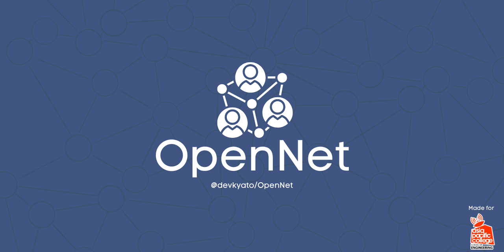

# OpenNet



[](https://github.com/devkyato/OpenNet/actions/workflows/ci.yml)
[](https://github.com/devkyato/OpenNet/releases)
[](LICENSE)
[](docs/protocol.md)

OpenNet is a focused, dependency-free messaging protocol I built for direct
links between embedded devices and a Python host—especially an ESP32 talking to
a Raspberry Pi or backend service. It is not a general cross-platform
communication layer or a replacement for MQTT, HTTP, or WebSocket. It sends
JSON, text, signed integers, finite doubles, booleans, null, and arbitrary binary
data over TCP/TLS or another reliable ordered stream.

Version 0.2.0 is an alpha release for real projects and learning. It has a
documented wire format, bounded resource use, retries and duplicate suppression,
native Arduino protocol tests, Python tests across 3.9–3.14, reproducible release
packages, measured local performance, and an optional topic-authorization hook.
It does not claim that a radio or internet route exists when the underlying
hardware or network is unavailable.

## What I wanted from OpenNet

I kept coming back to one idea: a sensor message should have the same bytes and
the same meaning whether it travels through an ESP32 Wi-Fi client, a serial
stream, or a Python TLS connection. I thought about reliability on that point
too, which is why retries keep the same message ID and receivers can suppress
recent duplicates without pretending the message is durably stored.

Why make ONP/1 when other protocols already exist? I wanted the framing, typing,
ACK behavior, limits, and cross-language test vectors to stay small enough to
read end to end. MQTT is the stronger choice for brokered fleets and retained
messages; HTTP and WebSocket are stronger when web ecosystems matter. ONP/1 is
for the narrower space where one embedded peer and one host need a direct,
inspectable contract without a broker.

- One small API and one frame format across ESP32 and Python.
- Typed values without a JSON dependency for every scalar or binary payload.
- Optional application ACKs, retry with stable message IDs, and bounded
  duplicate suppression.
- TCP/TLS over Wi-Fi, Ethernet, or routed networks.
- Generic Arduino `Stream` support for UART, USB serial, and Bluetooth Classic
  SPP on compatible ESP32 hardware.
- Strict control frames, CRC-32 corruption detection, payload limits, bounded
  queues, connection limits, and partial transport-write handling.
- Optional Python server authorization using the topic and verified TLS peer
  certificate before a handler runs or an ACK is sent.
- CLI tools to serve, send, ping, and benchmark.
- Arduino IDE, PlatformIO/VS Code, Python, Linux/systemd, and security tutorials.

## Install

Python wheel from the release page:

```sh
python -m pip install \
  https://github.com/devkyato/OpenNet/releases/download/v0.2.0/opennet_protocol-0.2.0-py3-none-any.whl
opennet --version
```

For an isolated command:

```sh
pipx install \
  https://github.com/devkyato/OpenNet/releases/download/v0.2.0/opennet_protocol-0.2.0-py3-none-any.whl
```

For Raspberry Pi/Linux, extract `OpenNet-linux-0.2.0.tar.gz` and run
`sudo ./install.sh`. It creates a hardened, unprivileged systemd service with a
loopback-only default. For Arduino IDE, install `OpenNet-0.2.0.zip` through
**Sketch > Include Library > Add .ZIP Library**.

The Python distribution is installable with pip, but v0.2.0 is distributed from
GitHub Releases rather than the public PyPI index.

## Five-minute local test

Terminal one:

```sh
opennet serve --echo
```

Terminal two:

```sh
opennet ping --count 5
opennet send sensor/temperature 24.7 --type float
opennet send device/state '{"online":true}' --type json
opennet benchmark --count 1000 --payload-size 64
```

Python code is equally small:

```python
import asyncio
from opennet import OpenNetClient

async def main():
    async with OpenNetClient("127.0.0.1") as client:
        message_id = await client.send(
            "lab/temperature", 24.7, retries=2
        )
        print("acknowledged", message_id)

asyncio.run(main())
```

The CLI defaults to loopback and refuses remote plaintext unless it is explicitly
allowed for a trusted development network. Use verified TLS—and mutual TLS when
device identity matters—outside isolated local testing.

## Evidence and design

- [Measured TCP/TLS and 20-client load results](docs/benchmarks.md)
- [Comparison with raw TCP, MQTT, WebSocket, and HTTP](docs/comparison.md)
- [Why ONP/1 exists and what it deliberately does not do](docs/design-rationale.md)
- [Architecture, ACK retry, and defensive boundaries](docs/architecture.md)
- [Certificate-to-topic authorization](docs/authorization.md)
- [Actual GitHub adoption counters and analytics limits](docs/adoption-analytics.md)
- [Transport support, including Bluetooth boundaries](docs/transports.md)
- [Arduino memory model and payload sizing](docs/embedded-memory.md)

Measured loopback results are software baselines, not invented Wi-Fi or hardware
claims. Hardware field reports are welcome through the
[compatibility process](docs/compatibility.md).

## Learn and build

- [Tutorials](docs/tutorials.md)
- [CLI reference](docs/cli.md)
- [Linux/Raspberry Pi service guide](docs/linux-service.md)
- [Getting started](docs/getting-started.md)
- [Development tips](docs/tips.md)
- [Security guide](docs/security.md)
- [ONP/1 protocol specification](docs/protocol.md)
- [Contributing](CONTRIBUTING.md)

Student contributions are welcome. Good changes include a reproducible test,
clear documentation, or a complete compatibility report. OpenNet follows
[Semantic Versioning](https://semver.org/) and is licensed under the
[MIT License](LICENSE).
