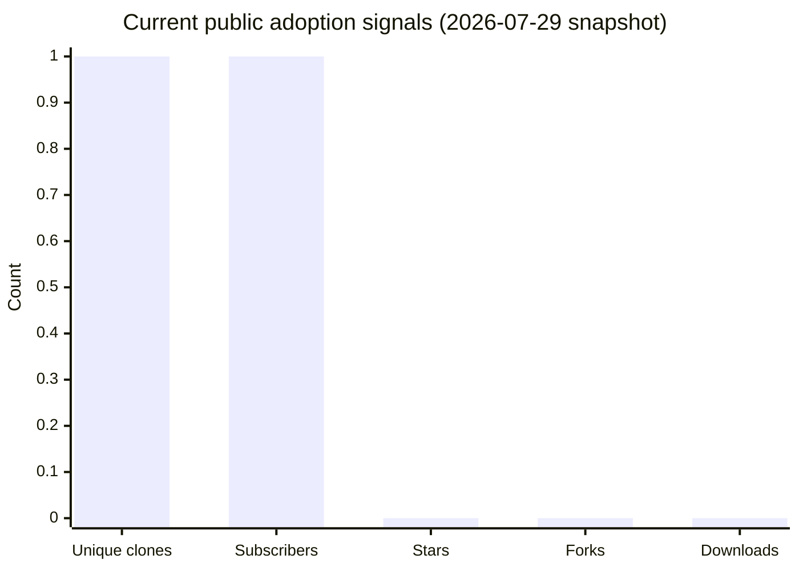

# Adoption analytics

OpenNet does not collect telemetry from library users. The only current adoption
signals are aggregate GitHub repository and release counters.

Snapshot queried from the GitHub API on 2026-07-29:

| Signal | Actual value |
|---|---:|
| GitHub views in returned 14-day window | 0 |
| Unique viewers in returned window | 0 |
| Git clones in returned window | 1 |
| Unique cloners in returned window | 1 |
| Stars | 0 |
| Forks | 0 |
| Watchers/subscribers | 1 |
| Open issues | 3 |
| v0.1.0 release asset downloads | 0 |

These values are a transparent early-project baseline, not evidence of a user
population. GitHub traffic is a rolling window and may lag. Demographic data
(age, location, school, occupation, or device ownership) is unavailable and
should not be guessed. Future releases can report platform compatibility and
opt-in survey results without adding tracking to the library.
