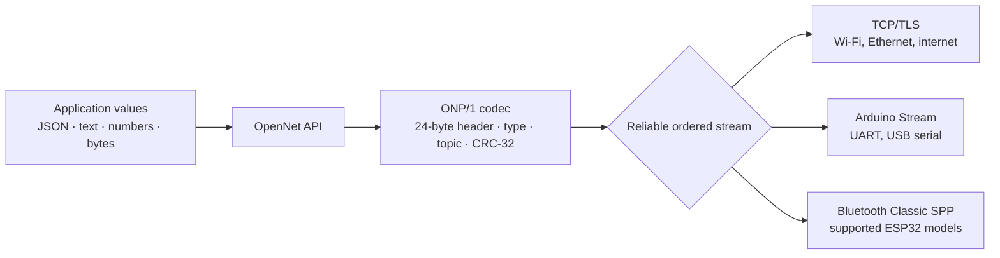
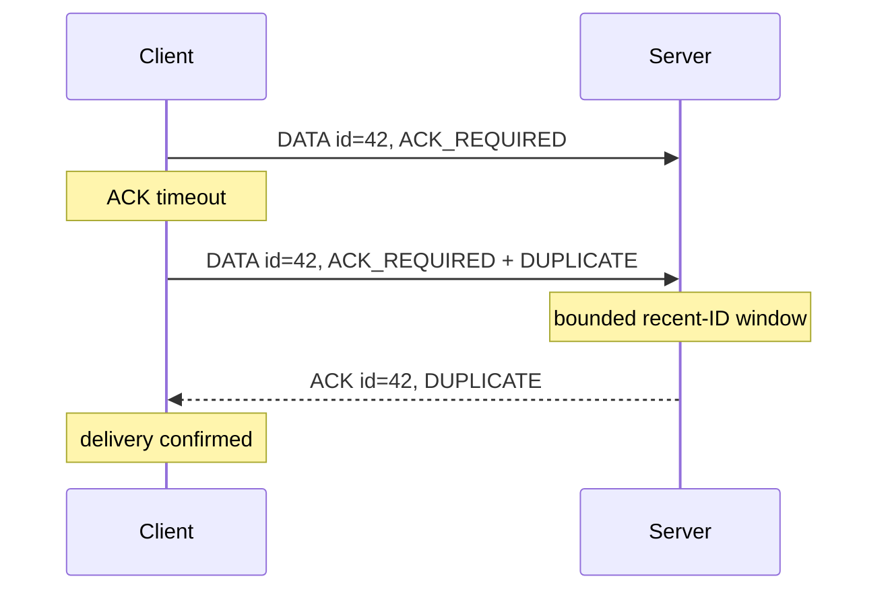
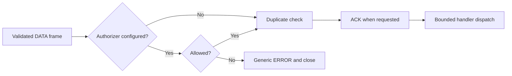

# Architecture

OpenNet separates ONP/1 framing from the byte stream carrying it. Both endpoints
must provide a reliable, ordered stream; Wi-Fi itself is not required.

I made that separation deliberately. A transport should only have to move bytes;
it should not get to redefine what a topic, type, ACK, or message ID means.
The tradeoff is equally deliberate: ONP/1 does not make an unreliable datagram
transport reliable. That responsibility belongs in an adapter below the codec.

The Python package provides the reference codec and asyncio TCP/TLS client and
server. The Arduino implementation accepts either a `Client` (`WiFiClient`,
`WiFiClientSecure`) or an already-open Arduino `Stream` (`Serial`,
`BluetoothSerial`). The frame bytes are identical across transports.

Arduino `poll()` has a configurable byte budget, partial writes have a total
deadline and cooperative yields, and ACK-required sends use an eight-entry
pending table. A caller-owned receive buffer plus `onMessageView` provides a
no-allocation OpenNet receive path for firmware that does not use the legacy
`String`/vector callback.

BLE GATT is packet-oriented, not a continuous byte stream. It needs an adapter
that fragments and reassembles ONP frames; v0.2.0 does not claim direct BLE
support. ESP32-C3/S3 boards also do not provide Bluetooth Classic SPP.

## Delivery and retry

Python retries reuse the message ID, and the server suppresses duplicate handler
execution within a configurable bounded window. The server ACKs after validation,
authorization, and duplicate admission, before it dispatches the application
handler. An ACK therefore proves transport acceptance, not handler success or
durability across power loss. Durable applications must persist outbound
messages, operation IDs, and application state.

## Delivery terms

- **Accepted at most once in a retained live-connection window:** retrying one
  message ID does not run its handler twice while that ID remains in the bounded
  window.
- **Not exactly once across reconnects:** message IDs are connection-local and
  the in-memory window is lost when the connection ends.
- **Potentially at least once across uncertain failure:** an application that
  replays after reconnect may cause the same logical operation again.
- **Application idempotency is required:** durable operation IDs and persisted
  results are needed when repeating an action would be unsafe.

## Python client dispatch

The Python client reader handles ACK, PING, PONG, CLOSE, and ERROR control frames
without waiting for application DATA consumption. DATA enters a bounded queue
with a deliberate overload policy: when the queue is already full, the client
sends a generic `receive queue full` ERROR and closes instead of blocking the
reader and hiding later control frames.

PING uses dedicated PONG waiters, so DATA received before a PONG remains in the
application queue rather than being repeatedly re-read. Outbound writes have a
configurable timeout, and message-ID allocation skips IDs still waiting for ACK.

The Python server admits new authorized DATA into a bounded per-connection
handler set, sends any requested ACK, and then dispatches the handler. Async
handlers run as bounded tasks; synchronous handlers run off the event loop.
Handler exceptions and timeouts increment counters without retracting an ACK
that has already reported transport acceptance. If the handler set is full, the
server sends a generic `handler queue full` ERROR and closes.

Server defaults also bound idle waits, incomplete headers, incomplete bodies
with a payload-size allowance, TLS handshakes, writes, and handler duration.
These values are configurable because a serial bridge and a local TCP service
can have very different safe timing envelopes.

## Authorization path

The optional Python authorizer runs after frame validation and before duplicate
handling, the application handler, or an ACK. I thought about this ordering
carefully: even a repeated message ID must pass the current topic policy.

The policy can inspect `Peer.tls_enabled`, `Peer.tls_peer_certificate`, and the
validated frame. This is an application API, not an ONP/1 wire-format change.
See [Authorizing topics](authorization.md).

## Defensive boundaries

- Payload, topic, receive-queue, connection, and duplicate-window bounds prevent
  unbounded routine growth.
- The CRC-32 catches accidental corruption before the application sees a value.
- Strict type and control-frame validation rejects malformed inputs.
- Remote CLI connections require TLS unless plaintext is explicitly enabled.
- TLS provides confidentiality and server identity; mutual TLS can also identify
  clients.
- Optional authorization can reject a peer/topic pair before application code
  or acknowledgement.

See [Security](security.md) for the trust model and [Transports](transports.md)
for supported connection types.
