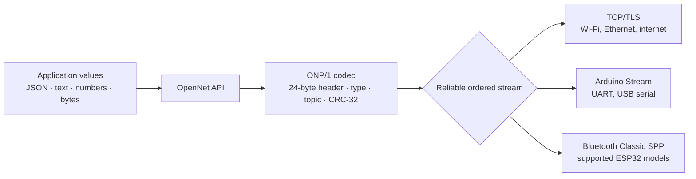
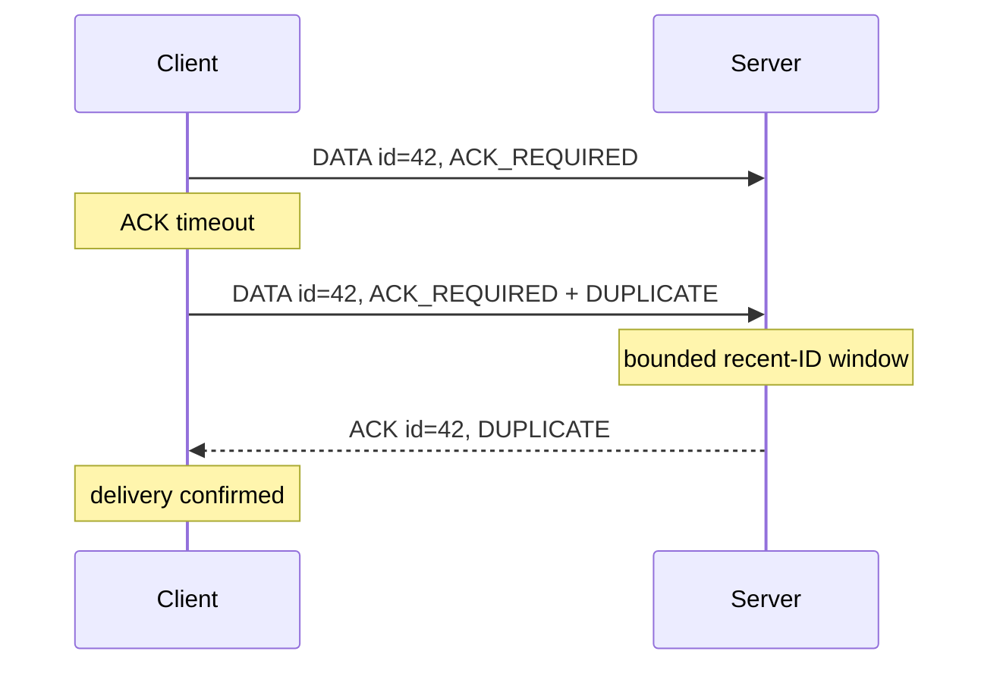
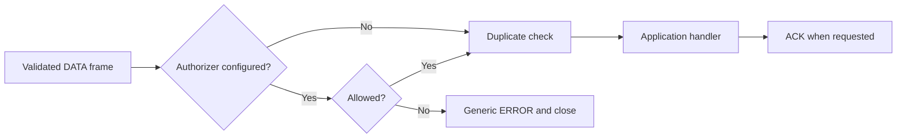

# Architecture

OpenNet separates ONP/1 framing from the byte stream carrying it. Both endpoints
must provide a reliable, ordered stream; Wi-Fi itself is not required.

I made that separation deliberately. A transport should only have to move bytes;
it should not get to redefine what a topic, type, ACK, or message ID means.

The Python package provides the reference codec and asyncio TCP/TLS client and
server. The Arduino implementation accepts either a `Client` (`WiFiClient`,
`WiFiClientSecure`) or an already-open Arduino `Stream` (`Serial`,
`BluetoothSerial`). The frame bytes are identical across transports.

BLE GATT is packet-oriented, not a continuous byte stream. It needs an adapter
that fragments and reassembles ONP frames; v0.2.0 does not claim direct BLE
support. ESP32-C3/S3 boards also do not provide Bluetooth Classic SPP.

## Delivery and retry

Python retries reuse the message ID, and the server suppresses duplicate handler
execution within a configurable bounded window. An ACK proves that the peer
parsed and accepted the frame; it does not make delivery durable across power
loss. Durable applications must persist outbound messages and application state.

## Authorization path

The optional Python authorizer runs after frame validation and before duplicate
handling, the application handler, or an ACK. I thought about this ordering
carefully: even a repeated message ID must pass the current topic policy.

The policy can inspect `Peer.tls_enabled`, `Peer.tls_peer_certificate`, and the
validated frame. This is an application API, not an ONP/1 wire-format change.
See [Authorizing topics](authorization.md).

## Defensive boundaries

- Payload, topic, receive-queue, connection, and duplicate-window bounds prevent
  unbounded routine growth.
- The CRC-32 catches accidental corruption before the application sees a value.
- Strict type and control-frame validation rejects malformed inputs.
- Remote CLI connections require TLS unless plaintext is explicitly enabled.
- TLS provides confidentiality and server identity; mutual TLS can also identify
  clients.
- Optional authorization can reject a peer/topic pair before application code
  or acknowledgement.

See [Security](security.md) for the trust model and [Transports](transports.md)
for supported connection types.
