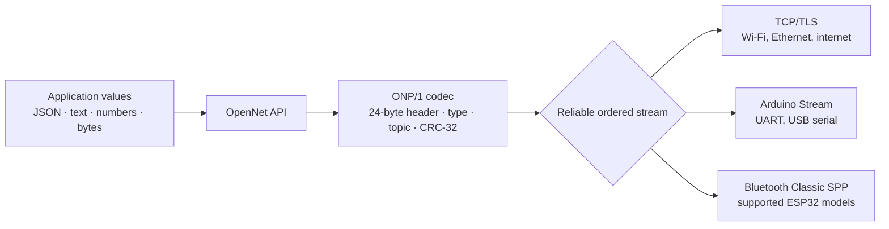
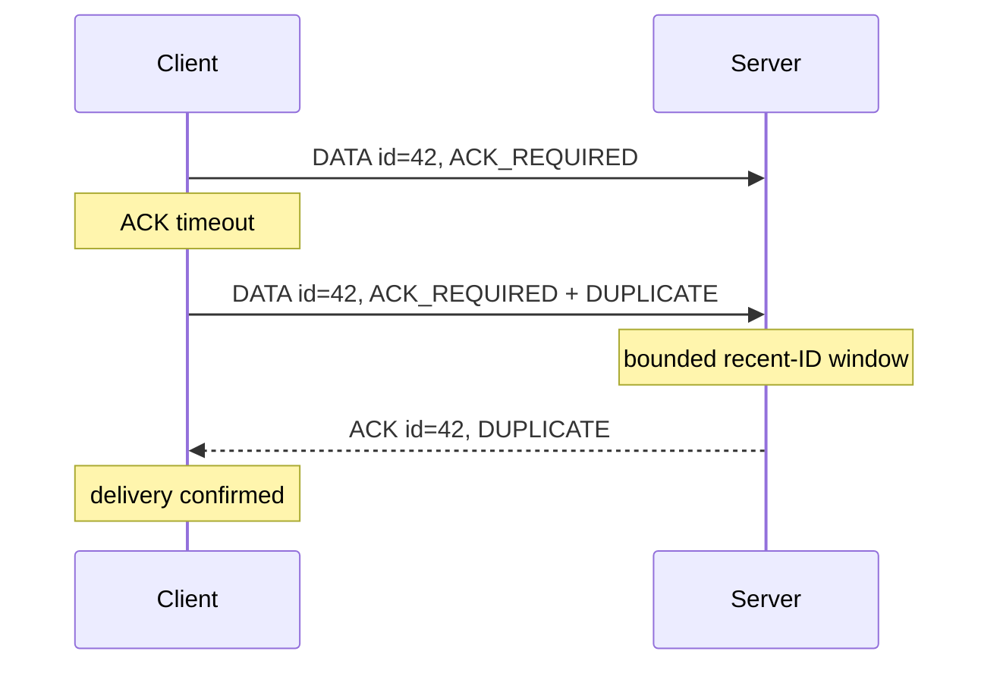

# Architecture

OpenNet separates ONP/1 framing from the byte stream carrying it. Both endpoints
must provide a reliable, ordered stream; Wi-Fi itself is not required.

The Python package provides the reference codec and asyncio TCP/TLS client and
server. The Arduino implementation accepts either a `Client` (`WiFiClient`,
`WiFiClientSecure`) or an already-open Arduino `Stream` (`Serial`,
`BluetoothSerial`). The frame bytes are identical across transports.

BLE GATT is packet-oriented, not a continuous byte stream. It needs an adapter
that fragments and reassembles ONP frames; v0.1.1 does not claim direct BLE
support. ESP32-C3/S3 boards also do not provide Bluetooth Classic SPP.

## Delivery and retry

Python retries reuse the message ID, and the server suppresses duplicate handler
execution within a configurable bounded window. An ACK proves that the peer
parsed and accepted the frame; it does not make delivery durable across power
loss. Durable applications must persist outbound messages and application state.

## Defensive boundaries

- Payload, topic, receive-queue, connection, and duplicate-window bounds prevent
  unbounded routine growth.
- The CRC-32 catches accidental corruption before the application sees a value.
- Strict type and control-frame validation rejects malformed inputs.
- Remote CLI connections require TLS unless plaintext is explicitly enabled.
- TLS provides confidentiality and server identity; mutual TLS can also identify
  clients.

See [Security](security.md) for the trust model and [Transports](transports.md)
for supported connection types.
