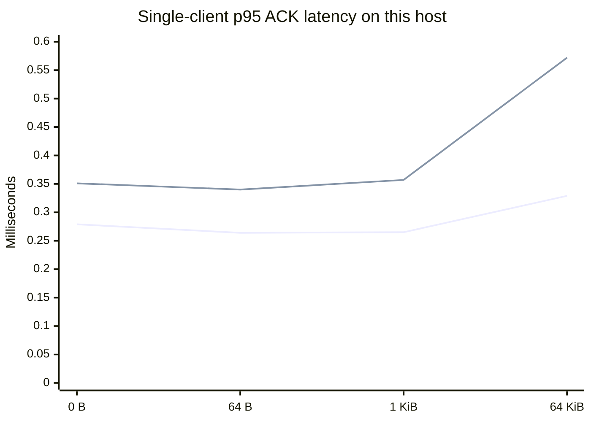

# Measured performance

These are actual controlled measurements from the v0.1.1 worktree on
2026-07-29. They are reproducible with `benchmarks/loopback.py`; they are not
estimates and are not presented as Wi-Fi, Bluetooth, Raspberry Pi, or ESP32
field results.

Environment: Windows 11 build 26200, AMD64 Family 25 Model 68, CPython 3.14.4,
IPv4 loopback. Each row uses one warm-up message per client and then times a
complete DATA-to-ACK round trip. TLS used a locally generated RSA-2048
certificate with certificate validation enabled.

| Transport | Clients | Payload | Messages | p50 | p95 | Mean | Throughput |
|---|---:|---:|---:|---:|---:|---:|---:|
| TCP | 1 | 0 B | 1,000 | 0.164 ms | 0.279 ms | 0.195 ms | 5,069.6 msg/s |
| TCP | 1 | 64 B | 1,000 | 0.156 ms | 0.264 ms | 0.178 ms | 5,566.1 msg/s |
| TCP | 1 | 1 KiB | 1,000 | 0.159 ms | 0.265 ms | 0.186 ms | 5,346.0 msg/s |
| TCP | 1 | 64 KiB | 1,000 | 0.224 ms | 0.329 ms | 0.245 ms | 4,045.8 msg/s |
| TLS | 1 | 0 B | 1,000 | 0.231 ms | 0.351 ms | 0.262 ms | 3,578.0 msg/s |
| TLS | 1 | 64 B | 1,000 | 0.226 ms | 0.340 ms | 0.254 ms | 3,843.5 msg/s |
| TLS | 1 | 1 KiB | 1,000 | 0.236 ms | 0.357 ms | 0.265 ms | 3,712.9 msg/s |
| TLS | 1 | 64 KiB | 1,000 | 0.361 ms | 0.572 ms | 0.434 ms | 2,270.7 msg/s |
| TCP load | 20 | 64 B | 2,000 | 2.879 ms | 5.296 ms | 3.177 ms | 5,861.5 msg/s |

## Interpretation and limits

The run proves that the codec, client, server, ACK path, concurrency handling,
and verified TLS path work together on this local device under the stated load.
Loopback removes radio interference and network hops, so these numbers are a
software baseline—not a prediction for a real deployment. Wi-Fi latency depends
on signal, access-point congestion, power saving, and hardware. Bluetooth SPP
depends on radio and serial baud/stack behavior.

For a field report, record the exact board, firmware, access point, distance/RSSI,
payload mix, TLS mode, run duration, reconnects, failures, and p50/p95/p99. The
[compatibility guide](compatibility.md) contains a report checklist.
