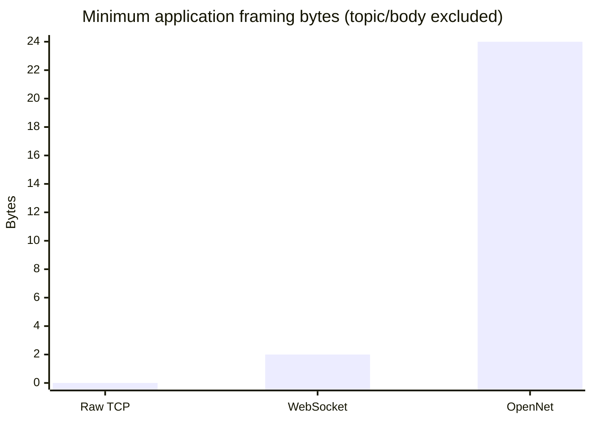
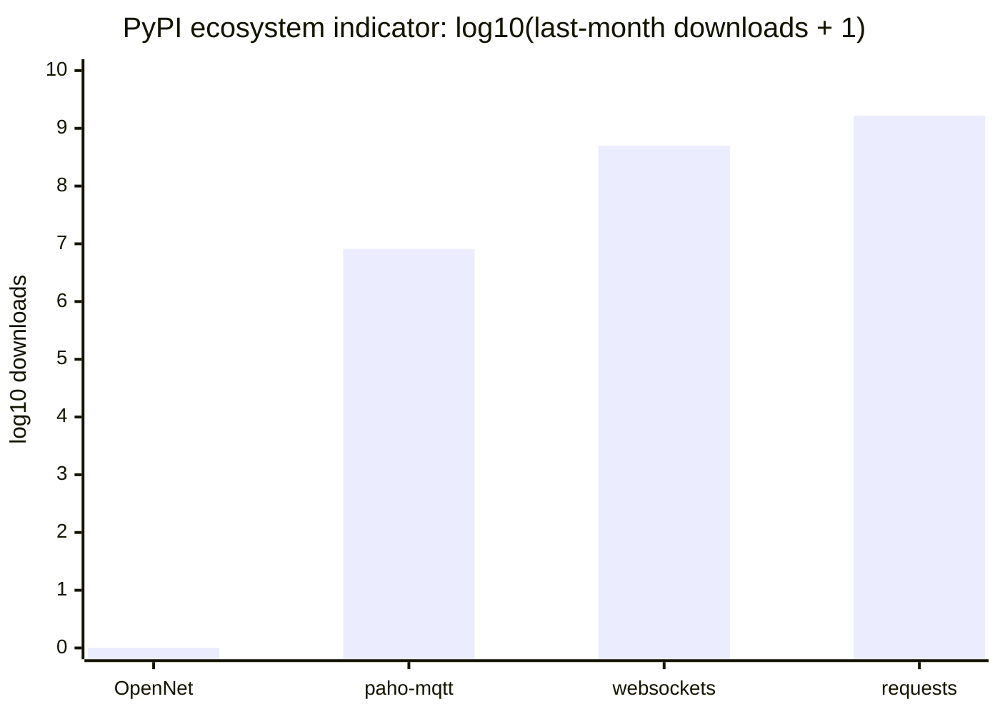

# Protocol comparison

OpenNet is a direct typed messaging option, not a universal replacement for
established web or broker protocols.

| Capability | OpenNet ONP/1 | Raw TCP | MQTT 5 | WebSocket | HTTP |
|---|---|---|---|---|---|
| Primary topology | Direct client/server | Whatever the app invents | Brokered pub/sub | Direct full-duplex | Request/response |
| Message boundary | Built in | None | Built in | Built in | Built in |
| App value types | 7 typed values | None | Application-defined bytes | Text/binary frames | Media type/body |
| Topics | Built in | None | Built in | Application-defined | URI/application-defined |
| Delivery signal | Optional ONP ACK | None at app layer | QoS 0/1/2 | None at app layer | Response status |
| Browser-native | No | No | Usually via WebSocket | Yes | Yes |
| Infrastructure | One peer listens | Application-defined | Broker | WebSocket server | HTTP server |
| Best fit | Small direct MCU/Python messaging | Custom low-level protocol | Fleet pub/sub and offline sessions | Browser full-duplex apps | Web APIs and integrations |

## Framing overhead

This graph is structural, not a speed benchmark. Raw TCP adds no application
framing and therefore supplies no message boundary. A WebSocket frame starts at
2 bytes and grows with payload length; client-to-server frames also carry a
4-byte masking key. OpenNet uses a fixed 24-byte header and then its UTF-8 topic
and payload. MQTT and HTTP overhead vary too much by properties and headers to
represent as one honest number.

## Choosing deliberately

- Choose **MQTT** when you need a broker, retained messages, subscriptions, or
  standardized QoS across a device fleet.
- Choose **WebSocket** when browser support is central.
- Choose **HTTP** when existing web tooling, caching, proxies, and REST semantics
  matter more than a compact persistent channel.
- Choose **raw TCP** when you are prepared to design, test, and maintain every
  application framing and typing rule.
- Choose **OpenNet** for direct, dependency-light typed messages shared by ESP32
  and Python code, with a small API and documented frame format.

Primary specifications: [MQTT 5.0 (OASIS)](https://docs.oasis-open.org/mqtt/mqtt/v5.0/mqtt-v5.0.html),
[WebSocket RFC 6455](https://www.rfc-editor.org/rfc/rfc6455.html), and
[HTTP Semantics RFC 9110](https://www.rfc-editor.org/rfc/rfc9110.html).

## Ecosystem usage indicator

This is an actual dated package-download indicator, not protocol market share.
PyPI Stats reported the following last-month downloads on 2026-07-29:

| Representative Python package | Protocol/use | Last-month downloads |
|---|---|---:|
| `paho-mqtt` | MQTT client | 8,134,970 |
| `websockets` | WebSocket library | 503,575,188 |
| `requests` | HTTP client | 1,678,041,738 |
| `opennet-protocol` | OpenNet | Not on PyPI; GitHub v0.1.0 assets had 0 downloads |

Established ecosystems are many orders of magnitude larger, which means more
integrations, operational knowledge, and independent testing. The counts also
include automation and repeat installs and exclude implementations in other
languages, so they must not be interpreted as unique people or deployments.
Source and method: [PyPI Stats API](https://pypistats.org/api/), which aggregates
public PyPI download data and excludes known mirrors.
